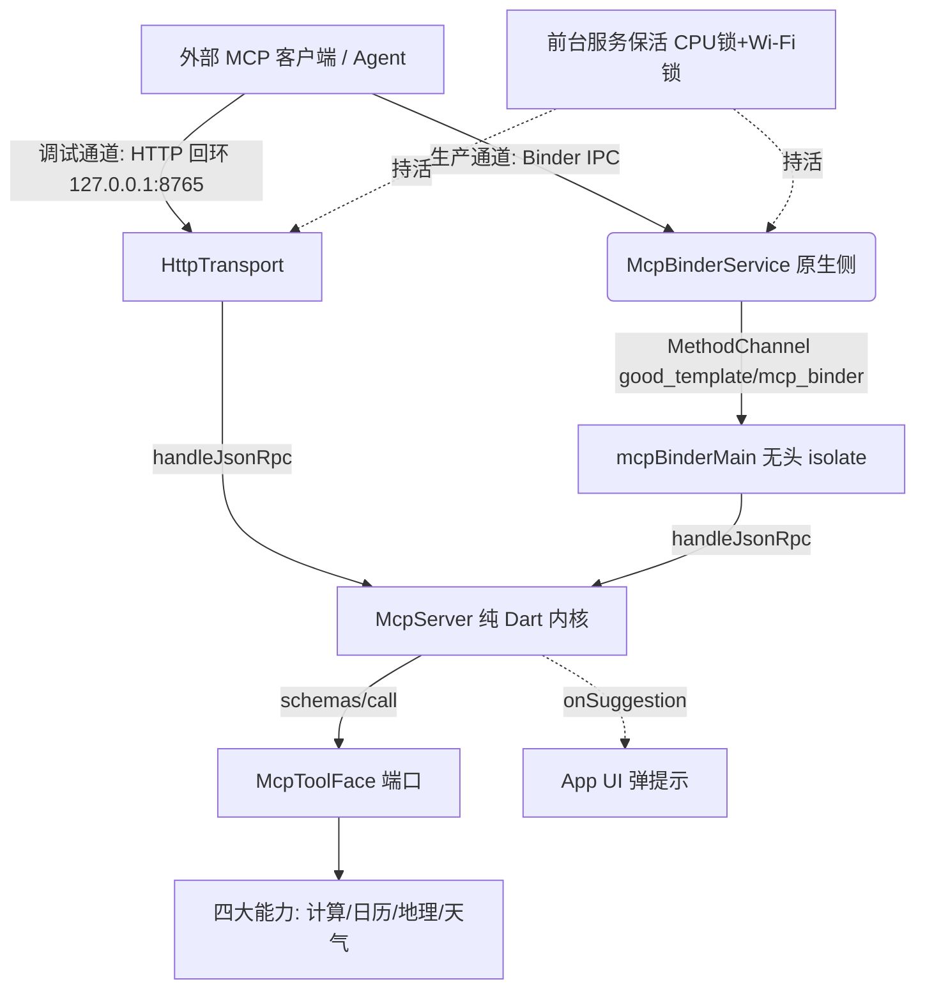

# goodTools · 产品概述

## 定位

goodTools 是面向**外部 MCP 客户端（Agent）**的**「生活时空基座 / 辅助服务」**：一个低频直接打开、高频后台运行的 Android 常驻基础设施，把用户设备上的可信本地能力（计算、日历、地理、天气）经 MCP 协议暴露给授权的 Agent 调用，而非面向终端用户的内容消费 App。

核心命题：**Agent 可信地调用本地能力**。App 本身不生产内容流，只做能力的「裁判 + 通道」——你（人）持有数据所有权，Agent 经 MCP 只读/受限写，敏感写入（如外观、身份画像）仅你本人在 App 内自决。

## 解决的痛点

- 外部 Agent 需要本地的、可信的、低延迟的辅助工具（算一笔账、查今天日程、拿当前坐标与方位、问三日天气），但不应各自重造、也不应无节制触碰隐私。
- 设备能力散落在系统 API 与权限沙盒里，Agent 直接调用既不可信也无统一鉴权。goodTools 把它们收敛成一个带信任边界的 MCP 服务面。

## 四大能力（产品范围）

| 能力 | 提供什么 | 典型工具面形态 |
|---|---|---|
| 计算器（life_math） | 表达式求值、比例/单位换算等数值计算 | 一个求值工具，返回结果 + 中间态 |
| 日历（calendar） | 读取系统日历日程，供查询/排程 | 按日/区间查询事件，敏感字段可按策略过滤 |
| 地理信息（geo，含指南针） | 当前经纬度、GCJ-02 火星坐标、行政区名、两点测距、指南针方位 | 坐标读取、测距、方位查询 |
| 天气（weather） | 城市维度的三日结构化预报 | 经可注入的 `WeatherProvider` 端口取数 |

四大能力经统一的 `McpToolFace` 端口注册（见 `lib/mcp/tool_face.dart`），新能力照此模板扩展，内核不感知具体业务。

## 系统形态

- **常驻壳**：Android 前台服务保活，Doze 下持 CPU 锁 + Wi-Fi 锁，保证 Agent 随调随应。
- **无头内核**：`McpServer` / `McpToolFace` / `SettingsKv` 均为纯 Dart，不依赖 Flutter UI 与 `dart:io`（传输层才沾 `dart:io`）。这意味着**删掉整个 UI，MCP 命令面仍完整可跑**——这是架构红线（arch-guard R4）的底座。
- **双通道**：
  - 生产通道 = **Binder IPC**：goodhub 宿主经 `bindService(BIND_AUTO_CREATE)` 拉起原生 `McpBinderService`，后者创建独立 headless `FlutterEngine` 执行 `mcpBinderMain`。同签名权限、零端口、零 `X-Api-Key`（`tokenProvider` 恒 `null`）。Binder isolate 与 `MainActivity` 主 isolate 互相独立，不依赖 App 是否在前台。
  - 调试通道 = **HTTP 回环**：`127.0.0.1:8765` 仅绑本机，带 `X-Api-Key` 鉴权与 origin/DNS-rebinding 防护，桌面经 `adb reverse` 接入；不广播 mDNS、不暴露局域网。

## 信任模型

| 通道 | 身份 | 鉴权 |
|---|---|---|
| Binder IPC | 同签名 goodhub 宿主进程 | 系统签名权限，零额外令牌 |
| HTTP 回环 | 本机桌面桥 / 直连客户端 | `X-Api-Key` 令牌（App「MCP 服务」页可查），仅 127.0.0.1 可达 |

敏感设置（用户身份画像、外观 `theme_mode`、天气城市等）仅用户本人在 App 设置页自设，Agent 经 `update_settings` 写入会被拒，只能推送「建议用户改设置」（`onSuggestion` → App 弹提示）。

## 实现基线（现状）

- MCP 内核纯 Dart，可脱离 Flutter 在 `test/smoke_test.dart` 全链路验证。
- 模板随附 `SampleToolFace`（演示 `ping` + 写命令 `note_put`，示范唯一写入口）与 `NullWeatherProvider`（天气端口的空实现，注入真实源即生效）。四大真实能力按 `McpToolFace` 模板落地即上工。
- UI 层尚未构建（无 `lib/ui`）；引入 UI 后 arch-guard 将完整启用 R1–R6 扫描。

## 相关文档

- 功能 → 代码落点索引：[project/index.md](../project/index.md)
- UI 开发规范（参考 goodhub 工业控制台范式）：[project/ui-design.md](../project/ui-design.md)
- 架构红线口径：仓库根 `AGENTS.md`
