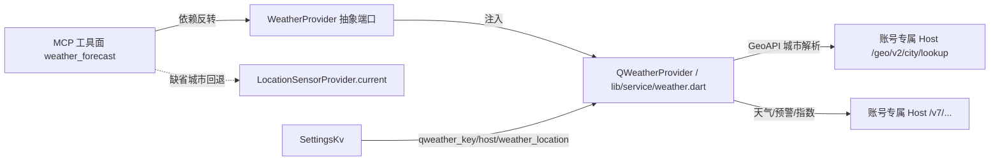

# goodTools · 天气能力（和风天气 API）

## 范围

基于**和风天气（QWeather）API** 提供天气查询，属产品四大能力之一。当前内核已定义 `WeatherProvider` 抽象端口（`lib/mcp/weather_provider.dart`），本能力为其 QWeather 后端实现（`lib/service/weather.dart` 落点）。

> 设计红线：内核（`lib/mcp/**`）只依赖 `WeatherProvider` 抽象端口 + `SettingsKv` + `LocationSensorProvider`/`GeoHttpProvider`，**不碰 `dart:io`、不直连网络**（arch-guard R4 无头约束）。真实 QWeather 联网与坐标读取由 service 层经端口注入，保证无设备/无网络环境下用 Mock 走通确定性单测。

## 架构边界与端口注入



- **内核纯 Dart、无头可跑**：`WeatherProvider` 接口与 `NullWeatherProvider` 默认空实现在内核，具体 `QWeatherProvider`（HttpClient）在 service 层；内核不感知具体后端与端点。
- **端口接缝**：与 `GeoHttpProvider` / `LocationSensorProvider`（`lib/mcp/geo_provider.dart`）保持同一依赖反转范式。
- **配置来源**：经 `SettingsKv` 读取（不直连 UI、不直连 `Db.instance`）。

## 配置项（SettingsKv）

| Key | 含义 | 默认值 | 说明 |
|---|---|---|---|
| `qweather_key` | 和风天气 API Key | 空 | 缺失 → `ERR_WEATHER_KEY_MISSING` |
| `qweather_host` | 账号专属 API Host | 空（**必填**） | 形如 `xxxx.re.qweatherapi.com`（控制台「项目管理」复制）；缺失 → `ERR_WEATHER_HOST_MISSING`；填错/未开通 → `ERR_WEATHER_HOST_INVALID` |
| `weather_location` | 用户预设城市（中文名/行政区） | 空 | 缺省回退链的第 3 级；Agent 无权写入（信任模型），仅用户在 App 设置页自设 |

> **Host 口径（2024 起，公共域名全线停用）**：实测 `devapi.qweather.com` / `api.qweather.com` 一律 403 `Invalid Host`，`geoapi.qweather.com` 一律 404 空体——公共域名**全部不可用**，天气端点与 GeoAPI 城市解析都必须走**账号专属 Host**（控制台「项目管理」复制，形如 `xxxx.re.qweatherapi.com`），它同时承载两者（GeoAPI 路径前缀 `/geo`）。Host 值在读取时**归一化**（去 `https://`、尾部 `/`、路径段，统一小写），用户直接粘贴控制台给出的 URL 也能用。
> **Host 与 Key 的关系**：Host 由系统按账号分配（每个账号唯一），**不是** Key 派生、不能猜；Key 必须与该 Host 属同一账号绑定，否则和风返回 403 `Invalid Host` 或「服务不可访问」。

## MCP 工具面契约

### `weather_forecast`

| 项 | 内容 |
|---|---|
| 档 | R（只读，无副作用） |
| 入参 | `{city?: string, lat?: double, lng?: double, days?: int}` |
| 出参 | `{success, city?, locationId?, now?, forecast[], alerts[], isCached, updateTime?, error?}` |
| 职责 | 获取实时 + 3~7 天结构化预报 + 气象预警；无参时依 `lat/lng → city → weather_location → geo_current` 回退链解析当地天气 |

**入参语义**

- `lat` / `lng`：经纬度（浮点，保留 2 位小数），与 `city` 二选一。**显式坐标优先级最高**（精确到具体点），且拼接时**经度在前、纬度在后**（见「和风传输层硬性约束」）。
- `city`：中文城市名/行政区（如 `"北京"`）。传入后必须先经 GeoAPI 解析为 `LocationID`（同名歧义见「两阶段查询」决议规则）。
- `days`：`1`~`7`，默认 `3`；`≤3` 走 `/v7/weather/3d`，`>3` 走 `/v7/weather/7d`。
- **缺省回退链**：`lat/lng` 与 `city` 皆为空时，按「缺省回退链（Fallback Chain）」逐级回退至 `weather_location` → `geo_current`，全部缺失才返回 `ERR_LOCATION_UNAVAILABLE`（不再跳过设置项）。
- 与日历联动：Agent 执行「本周日程 + 出行建议」时通常 `days=7`，结合日历事件、预警与降水判断。

### `weather_air` / `weather_indices` / `weather_astronomy` / `weather_minutely`（域深化四件，2026-10-24 起）

| action | 档 | 入参 | 出参 | 职责 |
|---|---|---|---|---|
| `weather_air` | R | `{city?, lat?, lng?}` | `{success, city?, updateTime?, air?: {aqi, category, primary?, pm10?, pm2p5?, no2?, so2?, co?, o3?}, isCached}` | 实时空气质量 AQI（`/v7/air/now`） |
| `weather_indices` | R | `{city?, lat?, lng?, days?: int(1\|3), type?: string}` | `{success, city?, updateTime?, indices: [{date, type, name, level, category, text}], isCached}` | 生活指数（`/v7/indices/1d\|3d`；`type` 为数字或逗号分隔多值，缺省省略由和风默认） |
| `weather_astronomy` | R | `{city?, lat?, lng?, date?: "YYYY-MM-DD"}` | `{success, city?, updateTime?, solar?: {sunrise, sunset, ...}, isCached}` | 日出日落（`/v7/astronomy/solar`；`date` 缺省设备今日） |
| `weather_minutely` | R | `{city?, lat?, lng?}` | `{success, city?, updateTime?, summary?, minutely: [{fxTime, precip}], isCached}` | 分钟级降水未来 2h 序列与文案总结（`/v7/minutely/5m`） |

- 四者共用 `weather_forecast` 的位置解析回退链、传输层硬性约束、配额护栏（singleflight/串行节流/429 冷却）与 TTL 缓存——**独立键位**（`air:`/`idx:`/`solar:`/`min:` 前缀），不与预报缓存互相命中；缓存回放同样标 `isCached`。
- 端点不在账号权限/配额内时按同一错误模型返回结构化失败（fail-closed，不静默空）。

### 缺省回退链（Fallback Chain）

当 `weather_forecast` 未传参（或入参 `lat/lng`、`city` 缺失）时，内核与 Service 层按以下严格顺序逐级回退，取首个有效定位；全部缺失再报错：

1. **入参显式 `lat, lng`**（优先级最高，精确到点）；
2. **入参显式 `city`**（经 GeoAPI 换 `LocationID`）；
3. **`SettingsKv` 用户预设 `weather_location`**（经 GeoAPI 换 `LocationID`）；
4. **传感器 `LocationSensorProvider.current()`** 当前经纬度（与地理能力 `geo_current` 联动；注意和风要求经度在前 `lng,lat`）；
5. 以上全部缺失且无定位权限/硬件 → 返回结构化错误 `ERR_LOCATION_UNAVAILABLE`。

> 关键点：原设计在步骤 3 与 4 之间跳过了 `weather_location`，导致「用户设了城市但无定位权限」时预设城市沦为摆设并误报 `ERR_LOCATION_UNAVAILABLE`。本链把设置项接回，消除死锁与断层。

### 出参契约（双轨）

成功：

```json
{
  "success": true,
  "city": "北京市 朝阳区",
  "locationId": "101010100",
  "updateTime": "2026-10-19T12:00+08:00",
  "isCached": false,
  "now": {
    "temp": "18",
    "text": "多云",
    "windDir": "东北风",
    "windScale": "2",
    "humidity": "45",
    "precip": "0.0"
  },
  "forecast": [
    {
      "date": "2026-10-19",
      "tempMin": "10",
      "tempMax": "20",
      "textDay": "晴",
      "textNight": "多云",
      "precip": "0.0"
    }
  ],
  "alerts": [
    {
      "id": "11000041600000_20261019",
      "title": "北京市发布雷电蓝色预警",
      "type": "雷电",
      "level": "蓝色",
      "text": "预计未来6小时内有分散性雷阵雨……"
    }
  ]
}
```

- `city`：和风返回的**完整行政链**（如「北京市 朝阳区」），非用户输入原词，消除重名县市语义歧义（决议规则见「两阶段查询」）。
- `now.precip`：实时降水量（mm），辅助 Agent 准确判定「出门要不要带伞」。
- `alerts`：气象灾害预警数组，无预警时**恒定返回 `[]`**（非空、不 null），每个元素结构为 `{id, title, type, level, text}`（`type` 如「雷电」、`level` 如「蓝色」），杜绝 Agent 消费时空指针；该接口为**弱依赖**，失败不影响主数据。
- 时间字段（`updateTime` 及内部的 `obsTime`/`fxTime`）为 **ISO 8601 带时区偏移**字符串（如 `2026-10-19T12:00+08:00`），**原样保真透传**；温度/降水为**纯数字字符串 + 隐式公制（°C / mm）**，如 `temp: "18"`。

失败（**永不返回 `null` / 空响应**，见下文错误模型）：

```json
{
  "success": false,
  "isCached": false,
  "error": {
    "code": "ERR_WEATHER_KEY_MISSING",
    "message": "和风天气 API Key 未配置",
    "suggestion": "请在 App 设置页填入 QWeather API Key"
  }
}
```

## 两阶段查询（Location ID 解析管道）

和风天气数据 API（`/v7/weather/now`、`/v7/weather/3d`、`/v7/weather/7d`）**绝大多数不支持直接传城市中文名**，强制要求 `LocationID`（`101010100`）或标准 `lng,lat`。

1. **入参为 `city`**：先经 GeoAPI 城市解析（**账号专属 Host**：`https://{qweather_host}/geo/v2/city/lookup?location={city}`）换取 `locationId`；解析结果为空 → `ERR_CITY_NOT_FOUND`。公共 GeoAPI 域名已停用，**不再兜底**（兜底只会拿到 404 空体并被误报成「查无此城」）。
   - **歧义决议（Disambiguation）**：GeoAPI 返回 `location[]` 多条目（重名县市，如「朝阳」可能是北京市朝阳区或辽宁省朝阳市）时，默认取**第一项**（和风按行政级别与权重降序排列）。
   - **出参 `city` 行政链**：取和风返回的完整行政链 `"${adm1} ${adm2} ${name}"`（如「北京市 朝阳区」）作为出参 `city`，消除 Agent 与用户的语义歧义，而非仅吐用户输入原词。
2. **入参为 `lat/lng` 或回退到 `geo_current`**：直接拼 `location={lng},{lat}` 查天气，跳过 GeoAPI。**注意和风规范为经度在前、纬度在后**，且浮点保留 2 位小数：`location=${lng.toStringAsFixed(2)},${lat.toStringAsFixed(2)}`；地理能力输出的是火星坐标 **GCJ-02**，和风可自动识别 GCJ-02 与 WGS-84，无需手动偏移，但顺序必须正确，否则会查到公海/南极。
3. **持久化城市代码映射缓存**：`city → locationId` 命中本地映射则免 GeoAPI 往返（独立 TTL，与天气数据缓存分离），降低频控压力与失败面。
4. **实时 + 预报并发聚合（预警弱依赖）**：`now`（`/v7/weather/now`）与 `forecast`（`/v7/weather/3d` 或 `/v7/weather/7d`）分属两个端点，Service 层用 `Future.wait([_fetchNow(), _fetchForecast()])` 并发拉取，二者共享同一 `LocationID` 与缓存生命周期，且**所有请求 URL 必须显式附带 `unit=m`（公制）**。预警 `/v7/warning/now` 为**弱依赖（Non-fatal）**：并行调用，遇网络异常/404/500 仅记 `[DEGRADE]` 日志并置 `alerts: []`，**绝不阻断** now/forecast 主数据输出；无预警同样填 `[]`。

## 和风传输层硬性约束

纯 Dart `HttpClient` 直连和风时最容易踩的物理对接坑，service 层必须显式防御：

- **Gzip 强制解压**：和风所有响应强制 `Content-Encoding: gzip`。`HttpClient` 必须 `autoUncompress = true`，或对响应流统一 `GZipCodec().decode()`；否则 `jsonDecode` 在二进制乱码上发生**不可逆崩溃**（JSON 解析断裂）。
- **错误体必须读出来**：4xx/5xx 的真实原因**只在响应体里**——和风给 JSON:API 形态 `{"error":{"status":403,"title":"Invalid Host","detail":"An invalid or unauthorized API Host."}}`，未开通服务的场景给中文「服务不可访问」。若对 4xx 直接 `drain` 丢体，用户只会看到笼统「鉴权失败」，无法自愈。必须解析错误体并把真因写进 `message`/`suggestion`。
- **Host 值归一化**：读取 `qweather_host` 后去掉 `https://`、尾部 `/`、路径段并统一小写，再拼进 `Uri(host:)`——否则用户粘贴控制台 URL 会拼出畸形 URI，失败原因难以定位。
- **经纬度顺序对齐**：用坐标查天气时，URL 拼接必须为 `location=${lng},${lat}`（**经度在前、纬度在后**），浮点保留 2 位小数。切勿按 `(lat,lng)` 习惯反向拼接。
- **公制单位显式声明**：所有天气请求 URL 必须显式附带 `unit=m`（公制），避免默认/环境差异返回华氏度引发 Agent 计算错误；出参 `temp`/`tempMin`/`tempMax`/`precip` 等约定为**纯数字字符串 + 隐式公制（°C / mm）**，如 `temp: "18"`。
- **HTTP 200 ≠ 业务成功**：和风在鉴权失败/欠费/无数据时，**HTTP 状态码往往仍是 200**，真实状态藏在 Body 的 `code` 字段。必须做响应体业务码拦截（见下）。

## 和风响应体业务码拦截（HTTP 200 内的错误）

> 业务级陷阱：和风在 Key 无效、额度透支、无权限、无地点数据时，HTTP 常为 200 OK，仅在 JSON Body 带状态码。若只信 HTTP 状态码，会拿着 `{"code":"401",...}` 去取 `now`/`forecast` 字段 → 空指针崩溃。

**拦截规范**：JSON 反序列化后，**第一步**校验 `body['code'] == "200"`；非 200 时按业务码翻译（与 HTTP 层错误码统一归并）：

| Body `code` | 映射错误码 | 含义 |
|---|---|---|
| `"401"` / `"402"` / `"403"` | `ERR_WEATHER_UNAUTHORIZED` | Key 无效、账号未绑定/额度透支、Host 错配、无接口权限 |
| `"404"` | `ERR_CITY_NOT_FOUND` | 该地点无天气数据（含 GeoAPI 查无此城） |
| `"429"` | `ERR_RATE_LIMITED` | 频控/配额耗尽（与 HTTP 层 429 同码） |

- 翻译后的信封统一带 `suggestion`，不向 Agent 透传原始业务码/堆栈。
- 时机：Transport 层先拦 HTTP 级 429/5xx/网络异常，Body 层再拦上述 200 内业务码，两层都收敛到同一错误枚举。
- **弱依赖豁免**：`alerts`（`/v7/warning/now`）即便返回非 200/404，也**不**走此拦截翻译，仅降级为空数组（见「并发聚合与部分降级」）。

## 缓存策略与频控（Rate Limiting）

开发版免费配额极低（日几千次、QPS 常限 20 甚至更低），Agent 多轮重复调用极易踩 429。

- **天气数据 TTL 缓存**：以 `locationId + 日期 + days` 为 Key，内存 + 持久化短时缓存，**默认 TTL 30 分钟**（可配 30min~1h）。`now` 与 `forecast` 视为同一缓存生命周期（同一次 `Future.wait` 的结果一并写入）。
- **命中即返回**：未过期直接回放缓存，并在出参打 `isCached: true`，不发起新请求。
- **频控自愈**：遇 429（HTTP 层或 Body `code:"429"`）时，若有未过期缓存则**自动回退最新缓存并标 `isCached: true`**（带降级日志 `[DEGRADE]`），否则返回 `ERR_RATE_LIMITED` 结构化错误，杜绝 Agent 幻觉。
- **配额护栏三件套**（provider 出网侧；Agent 并发调用与 UI 逐城聚合叠加时防风暴）：
  1. **并发合并（singleflight）**：同 `location#days` 的并发 `forecast` 共享同一次在途取数，不重复出网；
  2. **串行节流（pacing）**：不同 key 的取数经串行队列先到先服务，相邻起跑间隔默认 300ms（≈3 QPS 上限，留足开发版余量；注入口可关）；
  3. **429 冷却窗（cooldown）**：命中频控后默认 60s 内不再出网——有缓存（含过期）回放并标 `isCached`，无缓存返 `ERR_RATE_LIMITED` 并带冷却恢复指引；冷却截止由注入时钟驱动（可测）。
  - 三者均只作用于 `forecast` 出网路径；`searchCity`/`lookupCityByCoords`（用户手动触发、低频）不受冷却拦截。
- 缓存仅存天气投影，不含任何用户身份敏感字段。

## 错误模型（结构化自愈，杜绝静默 `null`）

> **反模式修正**：原设计「缺失时静默降级返回 `null`」是 Anti-pattern——Key 缺失/城市未设/配额耗尽时返回 `null`，Agent 会编造天气或给出无因失败。本能力**永远返回结构化信封**，与日历、计算器、地理（`GeoHttpException`）一致。

统一信封：`{success: false, error: {code, message, suggestion}}`。错误码枚举：

| code | 触发条件 | suggestion 指引 |
|---|---|---|
| `ERR_WEATHER_KEY_MISSING` | `qweather_key` 未配置（SettingsKv 读取为空） | 在 App 设置页填入 QWeather API Key |
| `ERR_WEATHER_HOST_MISSING` | `qweather_host` 未配置（公共域名已停用，天气与 GeoAPI 均需账号专属 Host） | 在 App 设置页填入账号专属 Host（控制台「项目管理」复制，形如 `xxxx.re.qweatherapi.com`） |
| `ERR_WEATHER_HOST_INVALID` | 账号专属 Host 无效或该 Host 未开通目标 API（和风 403 `Invalid Host` / 404「服务不可访问」等文案） | 核对 Host 拼写与账号归属、Key 是否与该 Host 同账号、该账号是否已开通对应 API |
| `ERR_WEATHER_UNAUTHORIZED` | HTTP/Body `401`/`402`/`403`：Key 无效、账号未绑定或额度透支、无接口权限（**Host 错配已单列为 `ERR_WEATHER_HOST_INVALID`**） | 核对 Key 绑定与额度及接口权限 |
| `ERR_CITY_NOT_FOUND` | GeoAPI 查无此城，或天气 Body `code:"404"` 无该地点数据 | 检查城市名/行政区写法，或改用经纬度查询 |
| `ERR_LOCATION_UNAVAILABLE` | 无 lat/lng、无 city、无 `weather_location`、且无定位权限/硬件 | 在设置页预设城市，或授予定位权限 |
| `ERR_NETWORK` | 网络异常 / 超时 / DNS 失败（HTTP 层） | 检查网络连接后重试 |
| `ERR_RATE_LIMITED` | HTTP 429 或 Body `code:"429"` / 配额耗尽（无可用缓存时） | 降低调用频率；已自动回退缓存时无需处理 |

- 所有异常在 service 层被捕获并**翻译**为上述信封，不向 Agent 抛原始堆栈/散文。
- 命名对齐现有约定：与地理 `ERR_AMAP_KEY_MISSING` 同构，采用 `ERR_<DOMAIN>_<REASON>` 前缀。

## 实现要点（端口与迁移）

- **端口签名修订**：`WeatherProvider` 不得再返回可空 `Map?` 以承载「静默 null」。建议改为：

  ```dart
  /// 返回结构化天气信封；任何失败 → 带 error 的成功/失败信封，永不 null。
  Future<WeatherResult> forecast({
    String? city,
    double? lat,
    double? lng,
    int days = 3,
  });
  ```

  `WeatherResult` 即 `{success, city, locationId, now, forecast, alerts, isCached, updateTime, error}` 的强类型映射（或直接 `Map<String,Object?>` 信封，但**不可为 null**）。
- `NullWeatherProvider`：未注入真实源时，返回 `{success:false, error: ERR_WEATHER_KEY_MISSING}` 信封（引导配置），而非 `null`。
- **QWeatherProvider**（`lib/service/weather.dart`）：聚合 GeoAPI 解析、Host 路由、TTL 缓存、频控回退、预警/指数、错误翻译；经 `SettingsKv` 读 Key/Host/预设城市，经 `LocationSensorProvider` 做缺省定位。
- **传输层防御**：`HttpClient` 开启 `autoUncompress = true`（或 `GZipCodec().decode()`），经纬度按 `lng,lat` 顺序拼接（见「和风传输层硬性约束」）；GCJ-02 坐标原样透传，不手动偏移；所有请求显式带 `unit=m`。
- **响应体业务码拦截**：反序列化后优先校验 `body['code'] == "200"`，非 200 按「和风响应体业务码拦截」表翻译，杜绝 HTTP 200 内错误导致的字段空指针（见对应小节）；`alerts` 弱依赖豁免该拦截。
- **时间戳保真**：`updateTime`/`obsTime`/`fxTime` 等时间字段**原样保真透传** ISO 8601 带偏移字符串；如需归一化须走 `package:timezone`，**严禁 `DateTime.parse()` 后丢弃 offset 转本地时间**，避免跨时区查询偏差。
- **并发聚合与部分降级**：`now` 与 `forecast` 用 `Future.wait([_fetchNow(), _fetchForecast()])` 并发拉取、共享缓存生命周期、均带 `unit=m`。**不返回残缺响应**：任一路失败先**重试一次**，仍失败转**缓存回退**（标 `isCached:true`），再失败才返回结构化 `ERR_*`（主响应以 `forecast` 为准，不单独吐半截 `now`）。**`alerts` 为弱依赖（Non-fatal）**：其请求失败（网络/404/500）仅记 `[DEGRADE]` 并置 `[]`，不阻断主数据，也不计入主响应重试/错误路径。
- **城市代码映射缓存**与**天气 TTL 缓存**的内核抽象（纯 Dart，可 Mock）定义在 `WeatherProvider` 侧或在 service 层注入一个 `CachePort`，避免内核沾 `dart:io`。

## 用户侧城市管理（多城市列表，2026-10-24 起）

- **定位**：城市增删是**用户本人自决**的写，命令族 `user_weather_city_add/delete` 只登记网关**用户侧注册表**（AI 不可触达，不进 MCP 工具面）；AI 查天气仍走 `weather_forecast` 单 action,默认城市语义不变（显式入参 > `weather_location` > 设备定位）。
- **存储**：`weather_cities` 键（SharedPreferences JSON 数组），条目 = `{id, name, lat, lng, locationId?}`；上限 10 条（配额护栏，开发版和风频控低）、重名（trim 后全等）拒绝不覆盖。
- **取数路径**：城市条目存**坐标**，UI 查天气按坐标直取（`/v7/weather/now` + daily），**不经 GeoAPI 城市解析**——城市解析只在「添加城市」时发生一次（搜索走 `WeatherProvider.searchCity` 多候选；地图选点走 `lookupCityByCoords` 坐标反查；均为 `/geo/v2/city/lookup` 类型化信封，「查无此城」= 成功空列表非错误）。
- **地图选点协同**：地图页「天气」分段激活选点模式 → 点地图落点（GCJ-02 原样透传）→ 坐标反查出候选（和风行政链名 + 城市质心坐标 + LocationID）→ 点「添加」经 `user_weather_city_add` 入列。条目与搜索添加**同源同构**（同名重名校验语义一致，取数同走坐标直查），AI 不可触达不变。
- **列表逐城摘要**：城市列表行内聚合各城实时摘要（temp/text + `isCached` 标记），与「点城市取数」**共用 provider 逐城 TTL 缓存**（同一 `location#days` 键）——摘要先行预热，命中零出网；未命中逐城串行补数（开发版配额护栏，避免并发取数触发频控）；失败行内给人话提示，点行看结构化详情。
- **UI 范式**：天气页 = 已添加城市列表 + 底部胶囊搜索条 + `DraggableScrollableSheet` 半/全屏面板（snap 档位/把手/搜索框快甩手势对齐地图页 `geo_page` 同款）；依赖门（缺 Key/Host）在搜索与取数两处均出「去设置」引导卡。

## 隐私

- `weather_location` 为用户自设低敏项；脱敏策略不涉及本能力。
- 取数全程失败统一走结构化错误信封，**不再静默降级**；错误 `message`/`suggestion` 面向 Agent 可读，不泄露 Key 原文与内部堆栈。

## 相关文档

- 产品概述：[overview.md](overview.md)
- 内核端口定义：`lib/mcp/weather_provider.dart`
- 地理/定位端口：`lib/mcp/geo_provider.dart`
- KV 持久化端口：`lib/mcp/settings_kv.dart`
- 工具面注册端口：`lib/mcp/tool_face.dart`
- 架构红线口径：仓库根 `AGENTS.md`

## 决策日志
- [2026-10-20] [决策]: 本轮**不装配**进 `tool_face_assembly.dart`——真实源（QWeatherProvider）未就绪时装配会让线级多一个恒返 `ERR_WEATHER_KEY_MISSING` 的空工具，属「能力假上线」；待 S5c 落地后随 S5d 一并装配。
- [2026-10-20] [决策]: 行政链**相邻重复段折叠**——和风在直辖市会把 adm1/adm2 都填「北京市」，直接按文档 `${adm1} ${adm2} ${name}` 拼接会得到「北京市 北京市 朝阳区」，与文档出参示例「北京市 朝阳区」不符。
- [2026-10-23] [决策]: **不接和风 SDK**（用户提示「和风天气有 sdk 可以使用」→ 评估后否决）：① pub.dev 无官方 Flutter SDK 包（仅社区插件 `flutter_qweather` 0.0.11，老且为原生插件，引入会破坏无头架构与 arch-guard 分层）；② 官方 SDK（Android/iOS/小程序）初始化同样是 `API Key + API Host`，**不消除「必须账号专属 Host」这一根因**；③ 本仓自研 provider 已覆盖端口契约 + 19 项真实链路单测，换 SDK 收益不抵迁移代价。结论：保留自研实现并加固。
