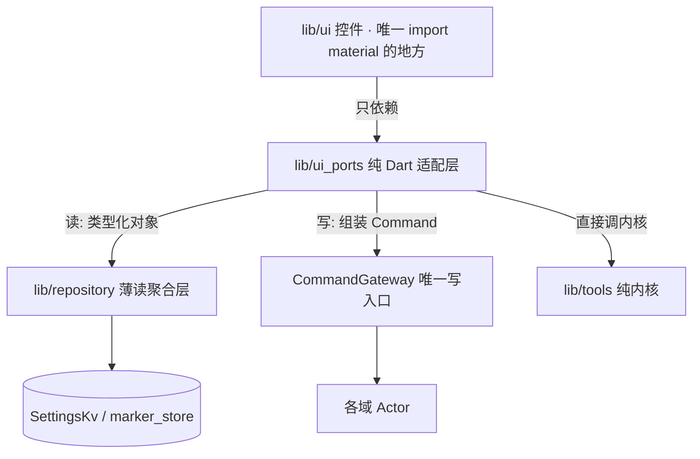

# goodTools · 控制台 UI（人前端）落地设计

> 本文是**人前端（UI）的功能设计稿**，与 [`ui-design.md`](ui-design.md) 分工明确：后者是视觉/交互的**终态规范 SSOT**（色彩 token、排印、布局标尺、无障碍红线），本文只管**页面级功能与接缝设计**——有哪些件、做什么、数据从哪来、写往哪去。规范与实现冲突时以 `ui-design.md` 为准。
>
> 本仓是**无头 MCP 壳**：纯 Dart 内核是唯一计算真相源，对外有**两个并列前端**——MCP 工具面（LLM 消费）与控制台 UI（人消费）。二者共享同一内核，走不同出口。MCP 前端已完成；**本文描述的是缺失的另一半**。

## 1. 定位与边界

goodTools 是**低频直接打开、高频后台运行**的基础设施工具，UI 不是内容消费 App，只承担三件事：

| 职责 | 说明 |
|------|------|
| **状态可见** | MCP 服务是否在跑、端口/令牌、权限与 Key 就绪矩阵、实时调用流水 |
| **自决配置** | 敏感设置（地图/天气 Key、脱敏开关、身份画像）**仅用户本人在此自设**——Agent 无权写 |
| **能力自验** | 能力 hub 与域子页面不依赖外部模型自行验证内核正确性（时空计算、日历快照、高精计算器、天气取数） |

**不做什么**：不生产内容流、不做日程管理（守 `calendar.md` 定位红线）、不把 UI 变成 MCP 工具面的下游消费者。

> **页面结构演进（2026-10-20 产品决策，见决策日志）**：三 Tab 骨架不变（仪表盘 / 能力 / 设置），原「沙盒」Tab 改为**能力 hub**（四张域卡入口），其下按域拆出**四个子页面**（计算器 / 日历 / 地图 / 天气）——让用户分开看到、用到各部分功能。子页面是「能力自验/自用」的页面级展开：**只读查询 + 本地计算 + 用户自有设置**，不是第二个 MCP 工具面（不消费文本信封，接缝纪律不变），更**不做日程管理**——不提供事件/标记增删改的 UI 入口（日程写操作归系统日历本身与 Agent 侧 W 档命令，UI 只读快照）。

## 2. 分层与接缝（三层，R1–R5 的物理落点）

| 层 | 位置 | 允许 import | 红线 |
|----|------|------------|------|
| 控件层 | `lib/ui/` | `lib/ui_ports`、Flutter material | 禁 `jsonDecode`（R2）、禁 `Platform.isX`（R3）、禁 `textScaleFactor`（R6）、禁直连 `Db.instance`（R5） |
| 适配层 | `lib/ui_ports/` | 内核（`lib/tools`/`lib/geo`/`lib/service` 端口）、`lib/action` 的 `Command`/`CommandGateway` | **纯 Dart 不 import Flutter**；可 headless 单测；禁在内部编解码 |
| 读聚合层 | `lib/repository/` | store / KV / Provider | UI 经此读，不直连存储 |

**关键纪律**：UI 拿到的是**类型化对象**（`EvalResult` / `ConvertResult` / 各域模型），**绝不**消费 `McpToolFace.call` 的 `{content,isError}` 文本信封——那必然触发 R2 `jsonDecode`，且把 UI 绑死 MCP 传输格式。

## 3. 页面规格

### 3.1 仪表盘 Dashboard

| 模块 | 数据来源 | 呈现 |
|------|----------|------|
| 概览 | — | 产品一句话（常驻壳定位） |
| 首页本体 = 钉住域二级页 | `SettingsRepository` 快照（设置键 `home_pinned_domain`；未设置/非法回落默认域 = 日历） | **首页直接内嵌钉住域的二级页面**（无快捷卡中间层，整个首页为此服务）——与能力 hub **共用同一份子页面实例**（main.dart 单点装配）；钉选在能力页（单选图钉控件） |

### 3.2 能力 Capabilities（hub + 四域子页面）

原「沙盒」单页滚长列表拆为 **hub 入口页 + 四个域子页面**（产品决策 2026-10-20：分开展示与使用各部分功能）。hub 是 Tab 级页面（NavigationBar 第二项），子页面经 push 进入（带返回）。

**hub（`capabilities_page.dart`）**：四张域卡——计算器 / 日历 / 地图 / 天气。每张卡带图标、域名称、一句话能力摘要、依赖说明（无需任何依赖 / 需日历权限 / 需高德 Key / 需和风 Key）。卡尾带图钉控件（**首页快捷单选**：设定仪表盘可直达的二级页面，默认日历；已钉卡呈实心图钉形状 + 「首页快捷」文字双通道；写经 `user_set_home_pinned_domain` 用户侧命令，AI 不可触达）。hub **不探测就绪态**（探测逻辑属仪表盘矩阵与各子页面自身，避免双源），只做入口与说明。

| 子页面 | 落点 | 功能 | 依赖与门 |
|--------|------|------|----------|
| 计算器 | `calculator_page.dart` | 表达式求值 + 单位换算；**双轨出参**（格式化串 + 无损 `numeric`） | 纯内核，零依赖恒可用 |
| 地图 | `geo_page.dart` | **交互地图画布**（`flutter_map` 纯 Dart + 高德 XYZ 瓦片源：手势缩放/点击选点/收藏 Marker/路线 Polyline 叠加，画布零原生依赖零 Key）+ 右侧浮动按钮列（我的位置/放大/缩小/指北重置）+ 底部上滑面板（搜索框常驻 + 五分段功能面：搜索/路线/收藏/测距/纠偏）+ 坐标纠偏（三系同屏）。LBS 经 `GeoLbsPort` **人机同源**（与 MCP 工具面共用同一 `GeoHttpProvider`） | 画布零 Key（decisions.md 2026-10-22：`amap_flutter_map` 退役）；「我的位置」走 geolocator 系统定位（`SystemLocationSensorProvider`，WGS-84 → GCJ-02 归一后落蓝点 + fit，与 MCP `geo_current` 共用单实例）；搜索/路线需 Web Key；纠偏/测距纯内核恒可用；瓦片源非官方承诺接口，失效降级静态图待接（域内待办）；**收藏写经 CommandGateway 用户侧注册表（AI 不可触达）** |
| 日历 | `calendar_page.dart` | 月格**信息层**（公历大日号 + 农历/节气副行 + 法定节假日「休」/ 调休「班」文字标，**离线、零权限依赖**）+ 某日事件与重要标记**只读快照**；未授权 → 警告卡 + 「去授权」（U12b） | 需 READ_CALENDAR 读事件；**只读**——不提供增删改；农历/节假日来自纯内核 `LunarMath` + `cnHolidayBundled`（2026 年度，2027 待录入） |
| 天气 | `weather_page.dart` | 城市 / 经纬度 + 天数 → 实时天气 + 逐日预报 + 预警 | 需和风 Key；缺失 → 引导卡跳转设置 Tab 配置 |

**通用纪律**（各子页面共享）：

- 数据来自**纯内核与 Repository 的类型化结果**，与 MCP 工具面并列共享同一内核；UI 只读展示，**绝不**消费 `McpToolFace.call` 文本信封。
- 子页面内**无写入口**（敏感设置的唯一写面 = 设置页，守 R1 单一心智）；需要配置的域（日历权限 / 天气 Key）以引导卡跳转到对应落点（系统设置 / 设置 Tab）。
- 平台差异（权限申请、跳转系统设置）经 service 层平台通道收敛，UI 禁 `Platform.isX`（R3）。

### 3.3 设置 Settings

| 段 | 职责 | 写路径 |
|----|------|--------|
| MCP 服务 | 启停、端口、令牌重生成、HTTP 端点 | 服务控制面（`McpController`）+ 用户命令 |
| 地图厂商 API Key | 明文不落盘 | **用户命令**（`user_set_api_key`） |
| 天气 Key | 同上 | **用户命令** |
| 脱敏开关 | 日程敏感字段过滤 / 模糊定位 | **用户命令**（`user_set_privacy_switch`） |
| 身份画像 | 用户自述身份（拼进 MCP 系统提示词） | **用户命令**（`user_set_identity_profile`） |
| 权限与配置就绪矩阵 | 逐域就绪探测（定位 / 日历 / 地图 Key / 天气 Key 药丸） | 只读探测（无写路径） |

错误态**情感化且可操作**：缺权限不崩溃，展示警告卡 + 一键跳转系统授权（经端口，不在 UI 写 `Platform.isX`）。

## 4. 写路径：用户命令族（信任模型的物理实现）

产品定位规定：**敏感设置仅用户本人在 App 内自设，Agent 经工具写入会被拒**。这需要机制而非文案：

- 新增**用户命令族**（`user_*` 前缀），登记在 `CommandGateway` 的**用户侧注册表**（`registerUser` / `dispatchUser`）。
- AI 侧注册表（`register`）与用户侧注册表**物理分离**：AI 只能触达 `CategoryTool` 枚举内的 27 个 action，用户命令**不可经 MCP 工具面到达**。
- 用户命令**同样经 `CommandGateway` 派发**（与 MCP 写档同一唯一写入口），但跳过 AI 专属的 `forbiddenKeys` 越权门——该门拦的是 AI，不是用户本人。
- 写后**回最新快照**（对齐读工具同形状），禁回 `void`。

> 为什么不能复用 `forbiddenKeys`：现有 `dispatch` 内部会调 `admits`，而 `admits` 命中 `forbiddenKeys` 即拒——若把用户设置键放进该表，用户本人通过 UI 的写也会被自己的门禁拦下。故用户命令走独立注册表，是**信任模型**与**越权门**两个语义的分离，不是绕过。

## 5. 持久化要求（数据面）

当前仅有 `InMemoryKv` 与 `InMemoryMarkerStore` 两个内存实现，**进程重启即丢**——token、API Key、订阅列表、身份画像、标记全部不落盘。这与 standards §4.2「数据面写失败必须可观测/可恢复」冲突，且 UI 一旦允许用户写设置即立刻暴露（用户填了 Key，重启消失）。

要求：

1. **KV 持久化实现**落地（键值表 + 原子写），装配期异步打开后注入。
2. **标记持久化**用既有 `SharedPrefsMarkerStore` 注入装配件，替掉 `InMemoryMarkerStore` 缺省。
3. **凭证零明文留痕**（standards §6.1）：Key 走系统安全存储抽象，不落明文 `SharedPreferences`；UI 只持开关态与掩码，不持明文回显。

落地状态（2026-10-20，U5 收尾）：

1. **已落**：`SharedPrefsKv` / `LazySharedPrefsKv`（Binder 同步装配用）+ `SharedPrefsMarkerStore` 均已注入装配件。
2. **已落**：凭证平台实现 `SecretStoreChannel.kt`（Android Keystore 持 AES-256-GCM 密钥、密文落专用 SharedPreferences）+ `KeystoreSecretStore`（Dart 侧 MethodChannel 封装），双引擎注册、装配期注入——**进程级、跨 isolate 可见、重启不丢、零明文留痕**；`InMemorySecretStore` 退位为 headless 单测替身。架构债 #1 据此结项。
3. **取舍留档**：Keystore 密钥**不设用户认证**——常驻壳的 Agent 经 Binder 随调随起须无解锁读凭证；威胁模型 = 设备物理沦陷（超出壳边界），密钥不可导出仍挡住提取式攻击。此取舍由产品定位决定，非疏忽。

## 6. 验收标准

| 项 | 判据 |
|----|------|
| 架构 | `toolbox run arch-guard` R1–R6 全过（UI 落地后 R1/R3/R5 的机械扫描**首次真正生效**） |
| 静态 | `flutter analyze` 0 issue |
| 行为 | `flutter test` 全绿（适配层与仓库层为纯 Dart，可 headless 单测） |
| 接缝 | UI 内 `jsonDecode` / `Platform.isX` / `textScaleFactor` / 直连 KV 四类命中数 = 0 |
| 视觉 | 真机侧载核对（环境无可用模拟器，唯一途径） |

## 7. 与既有文档的分工

| 主题 | SSOT 落点 |
|------|----------|
| 视觉/交互终态规范（色彩、排印、布局、无障碍） | [`ui-design.md`](ui-design.md) |
| 架构红线与门禁口径 | [`coding-standards.md`](coding-standards.md) §1.0 |
| 页面级功能与接缝设计（本文） | `docs/project/ui-console.md` |
| 功能 → 代码落点 | [`index.md`](index.md) 代码落点表 |
| 能力本身的产品定义 | `docs/product/*.md` |

## 相关文档

- UI 设计规范：[ui-design.md](ui-design.md)
- 工程规范：[coding-standards.md](coding-standards.md)
- 功能落点索引：[index.md](index.md)

## 决策日志
- [2026-10-20] [页面结构]: 用户拍板按域拆子页面——三 Tab 不变（仪表盘/能力/设置），原沙盒单页改为能力 hub + 四域子页面（计算器/日历/地图/天气，push 进入）。红线调和：子页面定位为「能力自验/自用」的只读查询 + 本地计算，**不做日程管理**（不提供事件/标记增删改 UI 入口，写归系统日历与 Agent 侧 W 档）；子页面无写入口，配置写仍只经设置页（R1 单一心智）；hub 不就绪探测（双源避免，探测归仪表盘矩阵与子页面自身）。ui-design.md §3.3 同步
- [2026-10-20] [SSOT修正]: domain_gateway.md 由 draft 转 active（26 action 全可用）；ui-design.md §1 回写 danger 校准值（暗 Rose 400 / 浅 Rose 700，按 §6 对比度红线）；coding-standards §1 分层矩阵新增 repository / ui_ports / ui 三域（standards §1.4 三处同步）
- [2026-10-20] [U5收尾]: SecretStore 平台实现定案 Android Keystore 路线——AES-256-GCM 密钥持于 AndroidKeyStore（不可导出），密文 Base64(IV‖密文) 落专用 SharedPreferences 文件（与普通设置物理隔离，复用进程级存储天然获得跨 isolate 可见性，无需自建 IPC）；**不设用户认证**（常驻壳 Agent 须无解锁读凭证；威胁模型=设备物理沦陷超壳边界）；fail-closed：密钥/密文异常透出 `SecretStoreException`，不吞 null 假装未配置。备选 EncryptedSharedPreferences（androidx.security-crypto）否决理由：该库已标记 deprecated 且 MasterKey 封装不透明，不利审计
- [2026-10-20] [Binder接入]: 插件接入 goodhub-mcp-sdk 拆仓——删自拷 AIDL（契约唯一物理副本改在 SDK 仓 :contract）；`McpBinderService` 由自写 `IMcpChannel.Stub` 改为继承 `GoodHubPluginService` + 重写 `handleJsonRpc` 接管路由（业务层留在 Dart，SDK 反射派发器不适用）+ `onHostCallback` 迁 `registerCallback` + 终帧推送走 SDK `tryEmitEvent`（保住 [DEGRADE] 可观测性）；F1 行为逐字保留；minSdk 由 24 提到 34（SDK 两模块硬要求，低于则 manifest merger 失败）
- [2026-10-20] [产品决策]: MCP HTTP 调试服务改**手动开启**——启动装配链不再自启（enable 在 ColorOS 上拖 5s+ 实证）；设置页移除「MCP 服务」卡，新增「关于」卡长按进隐藏服务页（启动/停止/重生成令牌 + adb reverse 直连步骤，无 Wi-Fi/LAN 暴露口径）；`enable` 内 startService 改 unawaited 后台补启不阻塞装配
- [2026-10-21] [交接]: goodhub 宿主侧 BinderTransport 由宿主实现闭环（AIDL 客户端/bindService/DeathRecipient/meta-data/Dart 调用面）；「空名 tool_call」根因实证 = BYOK GLM-5.3-Flash 流式 tool_calls 的 function.name 恒空，插件侧无响应形状适配义务；剩余真前端事项仅 U15 真机 e2e
- [2026-10-23] [日历信息层]: 月格从「12sp 等宽遥测日号 + 7dp 密度点」升级为「22sp 阅读轨大日号 + 农历/节气副行 + 法定节假日橙色日号 + 调休「班」文字标（§6 双通道：休/班兼文字通道、今日态改底部小圆点形状通道）」；数据面在 `ui_ports/calendar_port.dart` 新增纯 Dart `DayFacts`（`dayFacts`/`monthFacts`），复用 `LunarMath.describe` + `cnHolidayBundled.between`，不依赖系统日历权限（未授权页也不空）；新增 `dayNumber` 排印档（22sp 阅读轨，仅日历域）；节假日色复用既有 `l2Accent`（橙，喜庆强调），不扩调色板。页面外壳（默认切月视图 / 去日期输入 / 手势加速通道）待三拍板点确认后再动
- [2026-10-23] [日历外壳]: 按拍板落地极简 + 手势形态——默认**月视图**（去掉日独立视图 / TextField / SegmentedButton）；月格单一 `scale` 识别器复用「单指横滑切月」与「双指捏合收缩 → 年视图」；月份标题可点跳年 / 回月（§6 双通道：手势 + 可见箭头 / 标题 / 今天按钮 / 面板把手）；新增「今天」归位键；点日格 → **底部面板同屏展开**当日只读快照（上滑展开 / 下拉收起 / 点把手切换，180ms easeOut 非 Spring）；脱敏说明降级为面板内一行（U12a 保留）；未授权时农历 / 节假日仍离线可见，引导卡退为顶部横幅。日历页成为全仓唯一低密度页（去 SectionCard 容器）
- [2026-10-26] [仪表盘现态]: 仪表盘模块表与实现对账——服务状态卡 / 实时调用流水撤出（调用流水归 goodhub 宿主侧），权限就绪矩阵迁「设置」页（与配置项同页，改完即验）；仪表盘现承载概览 + 首页快捷
- [2026-10-26] [首页快捷]: 用户拍板把能力二级页面钉到仪表盘作快捷方式——单选钉选，默认日历；能力页域卡尾图钉控件（双通道：实心/轮廓图钉形状 + 「首页快捷」文字，ui-design §6）；两入口（hub + 仪表盘）共用同一份子页面实例（main.dart 单点装配，防状态双源）；写路径 = 新用户侧命令 `user_set_home_pinned_domain`（值域 = `AppDomain` 枚举名，Actor 校验，AI 不可触达），设置键 `home_pinned_domain` 不进设置页回显枚举；未设置/非法回落 = 渲染层口径（`resolvePinnedDomain` → 日历），写侧已值域校验，非法值只可能来自陈旧 KV
- [2026-10-26] [首页内嵌二级页]: 用户追加拍板——首页不留快捷卡中间层，**直接内嵌**钉住域二级页为首页本体（整个首页为此服务，去掉「卡 → 进入」一步）；子页根件原样嵌入（calendar/geo 自带 Scaffold、calculator/weather 裸件挂 HomeShell Scaffold 的 Material 祖先，不另包一层标题栏）；嵌入态 ShellNav 可用——日历「设置」/ 天气「去设置」引导在首页即活（优于 push 路由态）
- [2026-10-27] [日历外壳·年视图撤除]: 月视图无限滚动定稿为唯一导航后，年视图（整月/整年切换层）冗余撤除——撤 `_CalMode` 模式机制、`_buildYearMode`、快甩进年视图入口（`_kYearFlickVelocity`/`_kYearFlickPages`）、点标题跳年/回月（`_goYear`/`_goMonth`）、年视图点月落月（`_onMonthSelected`）与组件 `YearGrid`/`_MiniMonth`；2026-10-23 [日历外壳] 条目中「双指捏合收缩 → 年视图 / 月份标题可点跳年/回月」口径随之废止；现态手势 = 纵滑无限滚动切月（唯一导航，惯性可跨多月）+ 「今天」归位 + 点日格展开当日快照；固定星期表头一条钉在滑动条上方，月份内容其下无限滚动
- [2026-10-27] [日历外壳·自由滚动定稿]: 滑动条从「整月吸附」改**无限自由滚动**（用户拍板「可停在任何位置，比如上月一部分+这个月一部分」）——松手撤销速度/位移双阈值翻页与月边界吸附（`_kSwipeVelocity`/`_kSwipeRatio` 撤除），惯性滑行目标 = 当前位移 + 末速度 × 0.3 的**任意落点**（临界阻尼弹簧速度连续收敛，初速仍钳 2.5 页/s 保中间态可辨）；落定 `_settle` 重锚最近整月（p = round(−位移/页高)，锚点推进 p 月与位移补回 p 页原子换算，视觉逐像素不变），≤ 半页残差中间态原样保留；标题月改由条带位置**实时推导**（AppBar 内 ValueListenableBuilder + AnimatedSwitcher 跨半页换字，`_titleDirection` 由位移监听按页序号比较得出），`_commitMonth` 撤除；相邻月页**全部可点选**（月页缓存键去 `cur` 标记，跨月同屏是一等交互）；「今天」= 精确落位今天所在页后重锚归零，方向键从当前位置滑行一页；配套把 `_loadOverview` 密度失效从整表清空改**按槽位精准摘除**（自由滚动落定重锚持续预载新槽位，「新槽位首次有数据」不再把全部月份页实例换新）
- [2026-10-27] [日历外壳·自由滚动打磨]: ① 日格「1 号」上方标注所属月份（"N月"），自由滚动上/下月同屏日号连续时按该标注辨分界；② 标题换字动画由满幅 1.0 甩入改为克制同向淡入滑移（幅 0.4 + 淡入），消除穿帮式跳变观感
- [2026-10-27] [SSOT 修正]: 旧 2026-10-27 [日历外壳·年视图撤除] 年视图冗余撤除 ➔ 新 真机手感过关后用户拍板恢复年视图——年条带以月条带同构无限滚动条回归（纵滑跨年惯性 + ±2 预挂载），入口双通道 = 双指捏合（月→年收缩/年→月张开，Listener 原始指针）+ 点标题；点迷你月落月；「[日历外壳] 2026-10-23 条目中双指捏合收缩→年视图」口径随之复活，快甩进年视图入口不恢复（捏合/标题双通道已覆盖）
