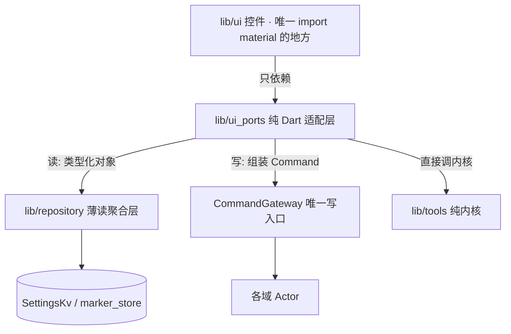

# goodTools · 控制台 UI（人前端）落地设计

> 本文是**人前端（UI）的功能设计稿**，与 [`ui-design.md`](ui-design.md) 分工明确：后者是视觉/交互的**终态规范 SSOT**（色彩 token、排印、布局标尺、无障碍红线），本文只管**页面级功能与接缝设计**——有哪些件、做什么、数据从哪来、写往哪去。规范与实现冲突时以 `ui-design.md` 为准。
>
> 本仓是**无头 MCP 壳**：纯 Dart 内核是唯一计算真相源，对外有**两个并列前端**——MCP 工具面（LLM 消费）与控制台 UI（人消费）。二者共享同一内核，走不同出口。MCP 前端已完成；**本文描述的是缺失的另一半**。

## 1. 定位与边界

goodTools 是**低频直接打开、高频后台运行**的基础设施工具，UI 不是内容消费 App，只承担三件事：

| 职责 | 说明 |
|------|------|
| **状态可见** | MCP 服务是否在跑、端口/令牌、权限与 Key 就绪矩阵、实时调用流水 |
| **自决配置** | 敏感设置（地图/天气 Key、脱敏开关、身份画像）**仅用户本人在此自设**——Agent 无权写 |
| **能力自验** | 沙盒页不依赖外部模型自行验证内核正确性（时空计算、日历快照、高精计算器） |

**不做什么**：不生产内容流、不做日程管理（守 `calendar.md` 定位红线）、不把 UI 变成 MCP 工具面的下游消费者。

## 2. 分层与接缝（三层，R1–R5 的物理落点）

| 层 | 位置 | 允许 import | 红线 |
|----|------|------------|------|
| 控件层 | `lib/ui/` | `lib/ui_ports`、Flutter material | 禁 `jsonDecode`（R2）、禁 `Platform.isX`（R3）、禁 `textScaleFactor`（R6）、禁直连 `Db.instance`（R5） |
| 适配层 | `lib/ui_ports/` | 内核（`lib/tools`/`lib/geo`/`lib/service` 端口）、`lib/action` 的 `Command`/`CommandGateway` | **纯 Dart 不 import Flutter**；可 headless 单测；禁在内部编解码 |
| 读聚合层 | `lib/repository/` | store / KV / Provider | UI 经此读，不直连存储 |

**关键纪律**：UI 拿到的是**类型化对象**（`EvalResult` / `ConvertResult` / 各域模型），**绝不**消费 `McpToolFace.call` 的 `{content,isError}` 文本信封——那必然触发 R2 `jsonDecode`，且把 UI 绑死 MCP 传输格式。

## 3. 页面规格

### 3.1 仪表盘 Dashboard

| 模块 | 数据来源 | 呈现 |
|------|----------|------|
| 服务状态卡 | `McpController`（running / port / token / lastError） | 状态点 + 文字双通道；令牌可复制（长按复制全串） |
| 权限就绪矩阵 | `ui_ports` 逐域就绪查询 | 定位 / 日历 / 地图 Key 药丸：正常=L1、未授权/缺失=灰阶、被拒=玫瑰；**被拒禁与缺失同灰阶混淆** |
| 实时调用流水 | `McpServer.onCall` 事件流 | `{name, ts, elapsedMs, ok}` 滚动列表，遥测轨等宽 |

### 3.2 沙盒 Sandbox

时空计算（当前坐标 / 火星坐标 / 测距）、日历快照（今日事件 + 重要标记）、高精计算器自测（表达式求值 + 单位换算）。**数据来自纯内核与 Repository 的类型化结果**，与 MCP 工具面**并列共享同一内核**；UI 只读展示。

计算器自测须展示**双轨出参**：格式化 `result` 串 + 无损 `numericValue`（与 MCP 侧口径一致，避免「UI 看起来准、Agent 拿到的是另一个数」）。

### 3.3 设置 Settings

| 段 | 职责 | 写路径 |
|----|------|--------|
| MCP 服务 | 启停、端口、令牌重生成、HTTP 端点 | 服务控制面（`McpController`）+ 用户命令 |
| 地图厂商 API Key | 明文不落盘 | **用户命令**（`user_set_api_key`） |
| 天气 Key | 同上 | **用户命令** |
| 脱敏开关 | 日程敏感字段过滤 / 模糊定位 | **用户命令**（`user_set_privacy_switch`） |
| 身份画像 | 用户自述身份（拼进 MCP 系统提示词） | **用户命令**（`user_set_identity_profile`） |

错误态**情感化且可操作**：缺权限不崩溃，展示警告卡 + 一键跳转系统授权（经端口，不在 UI 写 `Platform.isX`）。

## 4. 写路径：用户命令族（信任模型的物理实现）

产品定位规定：**敏感设置仅用户本人在 App 内自设，Agent 经工具写入会被拒**。这需要机制而非文案：

- 新增**用户命令族**（`user_*` 前缀），登记在 `CommandGateway` 的**用户侧注册表**（`registerUser` / `dispatchUser`）。
- AI 侧注册表（`register`）与用户侧注册表**物理分离**：AI 只能触达 `CategoryTool` 枚举内的 26 个 action，用户命令**不可经 MCP 工具面到达**。
- 用户命令**同样经 `CommandGateway` 派发**（与 MCP 写档同一唯一写入口），但跳过 AI 专属的 `forbiddenKeys` 越权门——该门拦的是 AI，不是用户本人。
- 写后**回最新快照**（对齐读工具同形状），禁回 `void`。

> 为什么不能复用 `forbiddenKeys`：现有 `dispatch` 内部会调 `admits`，而 `admits` 命中 `forbiddenKeys` 即拒——若把用户设置键放进该表，用户本人通过 UI 的写也会被自己的门禁拦下。故用户命令走独立注册表，是**信任模型**与**越权门**两个语义的分离，不是绕过。

## 5. 持久化要求（数据面）

当前仅有 `InMemoryKv` 与 `InMemoryMarkerStore` 两个内存实现，**进程重启即丢**——token、API Key、订阅列表、身份画像、标记全部不落盘。这与 standards §4.2「数据面写失败必须可观测/可恢复」冲突，且 UI 一旦允许用户写设置即立刻暴露（用户填了 Key，重启消失）。

要求：

1. **KV 持久化实现**落地（键值表 + 原子写），装配期异步打开后注入。
2. **标记持久化**用既有 `SharedPrefsMarkerStore` 注入装配件，替掉 `InMemoryMarkerStore` 缺省。
3. **凭证零明文留痕**（standards §6.1）：Key 走系统安全存储抽象，不落明文 `SharedPreferences`；UI 只持开关态与掩码，不持明文回显。

## 6. 验收标准

| 项 | 判据 |
|----|------|
| 架构 | `toolbox run arch-guard` R1–R6 全过（UI 落地后 R1/R3/R5 的机械扫描**首次真正生效**） |
| 静态 | `flutter analyze` 0 issue |
| 行为 | `flutter test` 全绿（适配层与仓库层为纯 Dart，可 headless 单测） |
| 接缝 | UI 内 `jsonDecode` / `Platform.isX` / `textScaleFactor` / 直连 KV 四类命中数 = 0 |
| 视觉 | 真机侧载核对（环境无可用模拟器，唯一途径） |

## 7. 与既有文档的分工

| 主题 | SSOT 落点 |
|------|----------|
| 视觉/交互终态规范（色彩、排印、布局、无障碍） | [`ui-design.md`](ui-design.md) |
| 架构红线与门禁口径 | [`coding-standards.md`](coding-standards.md) §1.0 |
| 页面级功能与接缝设计（本文） | `docs/project/ui-console.md` |
| 功能 → 代码落点 | [`index.md`](index.md) 代码落点表 |
| 能力本身的产品定义 | `docs/product/*.md` |

## 相关文档

- UI 设计规范：[ui-design.md](ui-design.md)
- 工程规范：[coding-standards.md](coding-standards.md)
- 功能落点索引：[index.md](index.md)

## 决策日志
- [2026-10-20] [SSOT修正]: domain_gateway.md 由 draft 转 active（26 action 全可用）；ui-design.md §1 回写 danger 校准值（暗 Rose 400 / 浅 Rose 700，按 §6 对比度红线）；coding-standards §1 分层矩阵新增 repository / ui_ports / ui 三域（standards §1.4 三处同步）
