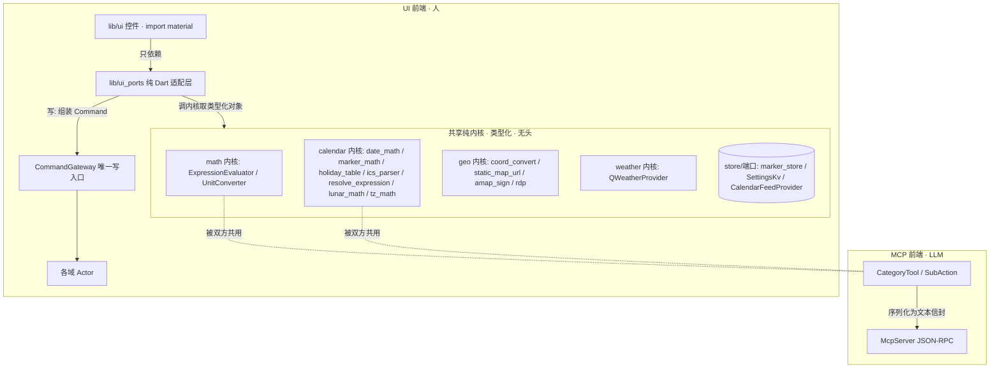

# goodTools · UI 设计规范（运行时控制台风格）

> goodTools UI 视觉与交互语言 **SSOT**。基调：工业实用主义 × 现代控制台质感——高密度、低装饰、确定性状态。继承 goodhub 工业控制台范式，并结合本仓 arch-guard 红线（R1–R6）与无头架构落地。
>
> **本文零外引**：不挂钩外部文档；红线（arch-guard R1–R6）SSOT 在 [`coding-standards.md`](coding-standards.md) §1.0，本文只承载视觉/交互，不重复红线。
>
> **总纲（三拒绝，全程有效）**：① 禁过度拟物；② 禁大面积渐变发光；③ 禁玩具式大圆角。
>
> **适用范围**：`lib/ui/` 一切界面（现存与未来新增）。

## 1. 色彩 Token（功能状态驱动）

背景一律低饱和冷中性色；高对比色彩**只用于系统状态**，禁装饰性用色。

| 角色 | Token | 参考值（深 / 浅） | 适用（goodTools 语境） |
|---|---|---|---|
| 底色基底 | 主题背景 | Zinc 900/950 · Slate 50/100 | 页面与阅读轨底色 |
| L1 就绪/成功 | `l1Ok` / `l1Info` | Emerald 400 · Cyan 500/600 | 服务运行、探活正常、调用成功、轻提示 |
| L2 写操作警示 | `l2Warn` / `l2Accent` | Amber 500 · Orange 400 | 配置变更确认、脱敏开关、模糊定位授权卡 |
| 危险/熔断/中止 | `danger` / `dangerDeep` | Rose 400（暗）· Rose 700（浅）· Crimson | 权限缺失、调用失败、准入被拒、中止键 |
| 数据指针 | `dataRef` | Indigo 400/500 | 经纬度、坐标句柄、`$ref` 缓存键、链接 |
| 终态/空闲灰 | `terminalMuted` | Gray 500 · Slate 500 | 终态锁定、空闲、服务未起 |
| 细边框 | `hairline` | 白基 / 黑基 12% | 全部 1dp 分隔线 |
| 代码底 | `codeBg` | 白基 / 深基 8% | 行内与块级代码底（JSON 预览 / 参数） |

> **色彩校准说明（实现期回写）**：`danger` 两处按 §6 对比度红线**上提/下移一档**——规范参考的 Rose 500 在卡片底上仅 4.06:1，跌破 4.5:1 正文红线，故暗色取 Rose 400、浅色取 Rose 700。`dangerDeep` 定为**实底填充**角色（配 `onDangerDeep` 前景），不作底色上的文字色，故不套正文红线。逐项对比度表见 `lib/ui/tokens/app_tokens.dart` 文件头注释。

## 2. 排印 Token（双轨分立）

| 轨道 | 字体 | 字号 | 规则 |
|---|---|---|---|
| 阅读轨（系统说明 / 设置项标签 / 按钮 / 权限药丸文字） | Inter / Roboto | 正文 14~15sp，行高 1.5~1.6 | 标题级数严格；代码块微深底 + 横向平滑滚动 |
| 遥测轨（时间戳 / 经纬度 / 计算结果 / 调用计数 / 端口号 / JSON 预览） | JetBrains Mono / Roboto Mono | 11~12sp（微标注 10.5sp） | 强制等宽；微弱底色容器包裹 |

- 遥测内容出现于阅读轨文本中**必须**包等宽容器；阅读内容禁用等宽。
- 面向用户的相位/状态文字用人话中文，内部英文相位名禁直出。
- 字号收敛到既定阶梯（正文 / 列表 / 紧凑 / 遥测 / 微标注 / 标题 / 日历日号各档，token 唯一出处 `lib/ui/tokens/`）；新增字号档位须先扩阶梯再使用，禁任意值。日历月格的「大日号」用专属 `dayNumber`（22sp 阅读轨，仅日历域使用，不进通用排版）。

## 3. 界面模块规格

### 3.1 仪表盘 Dashboard

| 模块 | 规格 |
|---|---|
| 概览 | 产品一句话（阅读轨正文） |
| 首页本体 | 直接内嵌用户钉住的域二级页（无卡片中间层，整页即钉住页；默认日历）；钉选控件在能力页（§3.3） |

### 3.2 实时调用流（数据流纪律）

```mermaid
flowchart LR
    K[lib/mcp 传输层: McpServer/McpToolFace] -->|onCall 调用事件| BUS[调用事件流]
    K -->|pushSuggestion 建议| SUG[设置建议流]
    C[McpController ChangeNotifier] -->|running/port/token/lastError| UI
    BUS --> UI[lib/ui 订阅]
    SUG --> UI
    KR[共享纯内核(类型化): lib/tools lib/geo lib/service 端口/store] -->|经 lib/ui_ports| UI
    UI -->|写: 组装 Command| GW[CommandGateway 唯一写入口]
    GW --> ACT[CalendarActor / 各域 Actor]
    UI -. 禁 import/吃文本信封 .-> K
```

- **只读订阅**：UI 经 `ChangeNotifier`（`McpController`）与 `Stream`（`McpController.suggestionStream`、`McpServer.onCall`）订阅内核状态，用 `AnimatedBuilder` / `StreamBuilder` 绑定刷新。
- **写必经网关**：任何用户触发的写（API Key、脱敏开关、身份画像）组装命令交 `CommandGateway.dispatch`，UI 不得直连 KV/Repository（R1/R5）。
- **实时调用流**：`McpServer.onCall` 在内核侧吐事件，UI 用 `StreamBuilder` 接——守住 R4。
- **读走类型化内核，不走 MCP 信封**：UI 经 `lib/ui_ports`（纯 Dart 适配层）调共享纯内核取**类型化对象**渲染；`lib/mcp` 的 `McpServer`/`McpToolFace` 是 **LLM 前端专属**的传输适配，UI 既不得 import 其传输类型，也不得消费其 `{content,isError}` 文本信封（否则必触发 R2 jsonDecode）。完整接缝与红线落点见 **§8**。

### 3.3 能力 Capabilities（hub + 四域子页面）

hub 入口页（Tab 级：仪表盘 / 能力 / 设置）+ 四个域子页面（计算器 / 日历 / 地图 / 天气，push 进入带返回）——不依赖外部模型自行验证服务准确；**数据来自纯内核与 Repository 的类型化结果**（与 MCP 工具面**并列共享同一内核**），UI 只读展示；**禁止消费 `McpToolFace.call` 的 `{content,isError}` 文本信封**（那是为 LLM 准备的，UI 吃了就要 jsonDecode，撞 R2——接缝与红线落点见 §8）。

- hub 域卡：图标 + 域名 + 一句话摘要 + 依赖说明；卡面点击热区 ≥44×44dp（§4.4），chevron 表「可进入」；尾部图钉控件（首页快捷单选钉）走双通道状态：实心/轮廓图钉形状 + 「首页快捷」文字（§6）。
- 域子页面顶部可带**依赖门**：日历未授权 = 黄色警告卡 + 「去授权」按钮；天气缺 Key = 警告卡 + 「去设置」按钮——情感化且可操作（§3.4 同口径）。
- 计算器/地图出参走**遥测轨**等宽容器（§2）；日历事件列表用阅读轨 + 时间列遥测轨混排。
- 子页面**无写入口**：配置写只发生在设置页（R1 单一写入口心智）；子页面只读查询与本地计算。

### 3.4 设置 Settings

| 段 | 职责 | 数据来源 |
|---|---|---|
| 地图厂商 API Key | 明文不落盘，走系统安全存储抽象 | `CommandGateway` 写 + `SettingsKv` 读 |
| 模糊定位模式 | 脱敏开关 | `CommandGateway` 写 |
| 日程敏感字段过滤 | 脱敏规则开关 | `CommandGateway` 写 |
| 身份画像 | 画像配置 | `CommandGateway` 写 |
| 权限与配置就绪矩阵 | 逐域就绪药丸（定位 / 日历 / 地图 Key / 天气 Key）：正常=L1、未授权/缺失=灰阶、被拒/错误=玫瑰；被拒禁与缺失同灰阶混淆 | 只读探测 |

- **错误态情感化且可操作**：缺权限不崩溃，展示黄色警告卡 + 一键跳转系统授权。
- **富通知栏**：`flutter_foreground_task` 的 `updateService` 周期推送（如「郑州·GPS就绪｜今日3项｜调用14次」），由状态流驱动。

## 4. 交互质感细则

1. **触觉**：L2 拦截卡弹出=双击警示震动；Abort/熔断=重度确认震动；L1 静默执行与完成=极轻微 tick。
2. **动效**：禁 Spring；用 Decelerate / Ease-Out 紧凑减速曲线；转场 150~200ms；状态点仅颜色相位过渡，禁缩放/弹跳。
3. **边缘**：卡片分割一律 1dp 细边框（0.5~1dp，10%~15% 不透明度）；禁大范围弥散投影。
4. **触控热区**：可点击区域 ≥44×44dp——视觉元素可小（7dp 点、11sp 标注），以透明 padding 补足，视觉不变。
5. **长文本截断**：Trace-ID/哈希中段省略（`7f3a…9c1e`）+ 长按复制全串；URI/路径末尾省略 + 横向平滑滚动，禁随意折行；超宽工具名单行 ellipsis。
6. **空态与占位**：空态=居中人话提示（限宽与页面同轴）；加载占位禁高亮扫光，用单色暗调极慢渐隐。
7. **Token 化**：色彩/字体/圆角/边框/动效时长一律取 design tokens（Flutter `ThemeExtension`），组件内禁散落魔法值——tokens 唯一出处 `lib/ui/tokens/`。
8. **手势优先（可替代点按即用手势）**：凡是能用连续手势替代离散点按的交互，**优先以手势作为主通道**——下拉收起面板、横滑切页/切年、双指捏合缩放、上滑展开等，更贴合自然隐喻（"拉下来关掉""滑一下翻页"）且降低精确命中成本（grabber/把手类目标的容错大于小按钮）。**但每条手势必须保留等价可见控件**（箭头 / 可点标题 / 把手 / 按钮）作双通道兜底——不得仅以手势承载关键操作（与 §6 双通道纪律同口径，无障碍不降级）。即"手势为主、点按为可见冗余"，而非"用手势取代点按"。

## 5. 布局标尺

| 标尺 | 取值 |
|---|---|
| 基线网格 | 4dp；间距阶梯 4 / 8 / 12 / 16（紧凑微调 6 / 10 / 14 须落在网格系内，禁任意值） |
| 圆角分级 | Badge/标签 4dp；按钮/小容器 8~12dp；卡片取 token `cardRadius`=10；**底部输入条（胶囊形）24dp**；其余全局禁 >16dp |
| 边框 | 1dp hairline，token 唯一出处 |
| 宽屏限宽 | 主内容居中 720dp；空态提示 560dp |

- **阶梯封闭**：新增尺寸一律落本表阶梯内；确需新档位先扩本表并同步 token，禁组件内私自取值。
- **输入条档位**：底部输入条是**唯一**允许的大圆角（胶囊形，24dp），与总纲③「禁玩具式大圆角」不冲突——承担「此处可输入」的形状识别功能，属功能形状而非装饰。

## 6. 无障碍红线

| 红线 | 规格 |
|---|---|
| 对比度 | 正文字色对底色 ≥4.5:1（WCAG AA）；11sp 级等宽微字 ≥3:1 |
| 双通道状态 | 禁仅以颜色传达状态：每个语义色必须伴随图标 / 形状 / 文字标签至少其一（色弱与强光下仅凭第二通道可判态） |

## 7. 反模式清单

- ❌ 在 `lib/mcp` `lib/action` 写 `import 'package:flutter/material.dart'`（R4）。
- ❌ UI 内 `repo.settingsSet(...)` / `Db.instance`（R1/R5）——走 `CommandGateway`。
- ❌ UI 内 `jsonDecode` / `textScaleFactor:`（R2/R6）。
- ❌ UI 消费 `McpToolFace.call` 返回的 `{content,isError}` 文本信封并 jsonDecode（R2）——UI 应经 `lib/ui_ports` 直接吃内核的**类型化对象**，与 MCP 工具面并列共享内核（见 §8）。
- ❌ UI 反向 import `lib/tools/**` 内部子类或 `lib/mcp/**` 端口实现并直调——统一经 `lib/ui_ports` 收口（R4 反向耦合）。
- ❌ UI 内 `if (Platform.isAndroid)` 分支（R3）——收进接口/工厂。
- ❌ UI 反向 import 内核类并直接调其方法绕过端口（无头约束根本破坏）。
- ❌ docs 内混入过程叙事、根目录平铺 `.md`、缺 frontmatter（见 docs-spec）。

## 8. 前端接缝与调用架构（无头双前端）

> 本仓是**无头 MCP 壳**：纯 Dart 内核是唯一计算真相源，对外有两个并列前端——**MCP 工具面（LLM 消费）**与 **UI（人消费）**。两者**共享同一内核**，但走不同的"出口"：MCP 把结果序列化成文本信封给 LLM，UI 直接拿**类型化 Dart 对象**渲染。
>
> **核心纪律**：UI 是内核的「并列前端」，**不是** MCP 工具面的「下游消费者」。UI **绝不** `import` `lib/mcp/**` 的传输类型，也**绝不**吃 `McpToolFace.call` 返回的 `{content,isError}` 文本信封（那是给 LLM 的，UI 吃了必然 `jsonDecode` → 撞 R2，且把 UI 绑死 MCP 传输格式）。
>
> 本节是 UI 接缝的 SSOT；§3.2 / §3.3 的调用纪律以此为准。

### 8.1 分层与双前端



- **内核层**：纯 Dart、类型化、可 headless 单测；结果以类型化对象（`EvalResult` / `ConvertResult` / 各域模型）表达，不是 JSON 文本。
- **MCP 前端**：`CategoryTool`/`SubAction` 是内核的**序列化包装**，把类型化结果包成 `{content:[{type:text,text:json}],isError}` 给 LLM。它**只服务 LLM**，不应被 UI 消费。
- **UI 前端**：`lib/ui` 控件只依赖 `lib/ui_ports`（纯 Dart 适配层），由 `ui_ports` 去调内核拿类型化对象、或组 `Command` 走 `CommandGateway` 写。

### 8.2 目录划分

| 目录 | 内容 | 允许 import | 红线 |
|------|------|------------|------|
| `lib/ui/` | Flutter 控件 / 页面 / tokens | `lib/ui_ports`、Flutter `material` | 禁 `jsonDecode`（R2）、禁 `Platform.isX`（R3）、禁 `textScaleFactor`（R6） |
| `lib/ui_ports/` | **纯 Dart** UI 适配/视图模型层（不 import Flutter） | 内核（`lib/tools`/`lib/geo`/`lib/service` 端口与 store）、`lib/action` 的 `Command`/`CommandGateway` | 自身不得 import `material`；禁在内部 json 编解码 |
| `lib/repository/`（待建薄层） | 读聚合抽象，包 `marker_store`/`SettingsKv`/ICS，供 `ui_ports` 与（未来）其他前端共用 | store / KV / Provider | R5：UI 经此读，不直连 `Db.instance` |

> `lib/ui_ports` 保持纯 Dart 的意义：可被 headless 单测覆盖（与内核同标准），且不污染无头约束。`lib/ui` 才是唯一允许 `import 'package:flutter/material.dart'` 的地方。

### 8.3 调用铁律（红线落点）

1. **R4（反向耦合）**：`lib/mcp/**` 与 `lib/action/**` 不得 import `lib/ui/**`；同时 UI 也**不得** import `lib/mcp/**` 的传输类型与 `lib/tools/**` 的内部子类——一律经 `lib/ui_ports` 收口。
2. **R2（JSON 编解码）**：UI 渲染的数据必须是**类型化对象**（`EvalResult` / `ConvertResult` / 领域模型）。`lib/ui` 内出现 `jsonDecode` / 手写 `jsonEncode` 即违例（仅 `settings_page.dart` 导出预览豁免）；类型化对象由内核/`ui_ports` 负责构造。
3. **R1（唯一写入口）**：任何用户触发的写（Key、脱敏开关、标记增删、ICS 订阅）在 `lib/ui_ports` 组装 `Command` → `CommandGateway.dispatch`，与 MCP W 档**同一通道、同一鉴权**。UI 与 `ui_ports` 都不得直写 store / KV。
4. **R5（Repository）**：UI 读 marker / settings / ICS 经 `lib/repository`（待建）或既有 store 的类型化读取接口，不直连 `Db.instance`。
5. **R3（平台分支）**：位置权限、时区源、传感器可用性等平台差异收进 `lib/mcp` 端口/工厂（如 `LocationSensorProvider`），`lib/ui` 不写 `if (Platform.isAndroid)`。

### 8.4 参考骨架（calculator 屏）

> 用真实内核 API（`ExpressionEvaluator.evalExpression`、`UnitConverter.convert`）演示「UI 吃不透明类型化对象、写经 CommandGateway」，**无任何 jsonDecode**。

`lib/ui_ports/calculator_port.dart`（纯 Dart，不 import Flutter）：

```dart
import '../tools/math/expression_evaluator.dart'; // EvalResult / ExpressionEvaluator
import '../tools/math/unit_converter.dart';        // ConvertResult / UnitConverter

/// UI 用的类型化视图模型——绝不透传 McpToolFace 的文本信封。
class CalcView {
  const CalcView({
    required this.ok,
    this.text,
    this.numeric,
    this.errorCode,
  });
  final bool ok;
  final String? text;     // 格式化展示串
  final String? numeric;  // 机器数值（Decimal 字符串，超范围不丢精度）
  final String? errorCode;
}

/// 计算器 UI 适配层：收口内核调用 + 错误归一，供 lib/ui 直接消费。
class CalculatorPort {
  const CalculatorPort(this._converter);
  final UnitConverter _converter;

  CalcView eval(String expr) {
    final r = ExpressionEvaluator.evalExpression(expr); // → EvalResult
    if (!r.ok) return CalcView(ok: false, errorCode: r.error!.code);
    final v = r.value!; // Decimal
    return CalcView(ok: true, text: v.toString(), numeric: v.toString());
  }

  CalcView convert(double value, String from, String to) {
    final r = _converter.convert(value, from, to); // → ConvertResult
    return r.success
        ? CalcView(ok: true, text: '${r.value} $to', numeric: '${r.value}')
        : CalcView(ok: false, errorCode: r.code);
  }
}
```

`lib/ui/calculator_screen.dart`（只 import Flutter + `ui_ports`，直接渲染类型化字段）：

```dart
import 'package:flutter/material.dart';
import '../ui_ports/calculator_port.dart';

class CalculatorScreen extends StatefulWidget {
  const CalculatorScreen({super.key});
  @override
  State<CalculatorScreen> createState() => _CalculatorScreenState();
}

class _CalculatorScreenState extends State<CalculatorScreen> {
  final _port = CalculatorPort(const UnitConverter());
  CalcView? _last;

  void _onSubmit(String expr) => setState(() => _last = _port.eval(expr));

  @override
  Widget build(BuildContext context) {
    // 直接渲染 _last.text / _last.numeric —— 无任何 jsonDecode（R2 合规）
    final v = _last;
    return Column(
      children: [
        TextField(onSubmitted: _onSubmit),
        if (v != null)
          Text(v.ok ? '${v.text}' : '错误: ${v.errorCode}'), // 遥测轨包等宽容器见 §2
      ],
    );
  }
}
```

写操作示例（`lib/ui_ports/calendar_port.dart`，与 MCP W 档同通道）：

```dart
import '../action/command_gateway.dart';        // CommandGateway / Command
import '../action/calendar_commands.dart';      // CalendarMarkerAddCommand

class CalendarPort {
  const CalendarPort(this._gateway);
  final CommandGateway _gateway;

  /// UI 添加标记：组装 Command 走唯一写入口，与 calendar_marker_add 动作同鉴权。
  Future<void> addMarker(Map<String, Object?> params) async {
    final cmd = CalendarMarkerAddCommand(params); // 命令名 == action 名
    await _gateway.dispatch(cmd);                 // R1：写必经网关
  }
}
```

### 8.5 双前端校验漂移（纪律）

两条前端并列后，参数校验/语义会存在两份（MCP 侧在 `SubAction` 做 stringly-typed 校验，UI 侧用类型化签名）。防漂移：

- **校验下沉内核**：非法入参由内核抛结构化错误（`MathError` / `ResolveException` / 各域错误），前端只做薄转发，不在两边各写一套业务规则。
- **`ui_ports` 是唯一转发点**：UI 控件禁止散落直调内核内部类；所有内核调用经 `lib/ui_ports`，便于统一 loading/error 与回归。
- **不重复实现算法**：纯内核（math 内核、`date_math` 等）已是单一真相源，`SubAction` 与 `ui_ports` 都只是它的包装，不得各算一遍。

## 相关文档

- 工程规范（架构红线 / 分层 / 工具面契约）：[coding-standards.md](coding-standards.md)
- 功能 → 代码落点索引：[index.md](index.md)
- 产品概述（能力/架构/信任模型）：[../product/overview.md](../product/overview.md)
