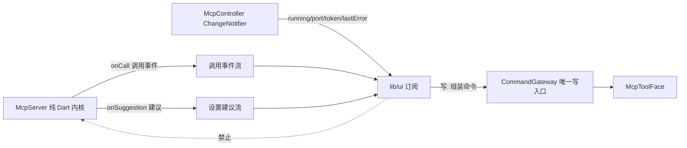

# goodTools · UI 设计规范（运行时控制台风格）

> goodTools UI 视觉与交互语言 **SSOT**。基调：工业实用主义 × 现代控制台质感——高密度、低装饰、确定性状态。继承 goodhub 工业控制台范式，并结合本仓 arch-guard 红线（R1–R6）与无头架构落地。
>
> **本文零外引**：不挂钩外部文档；红线（arch-guard R1–R6）SSOT 在 [`coding-standards.md`](coding-standards.md) §1.0，本文只承载视觉/交互，不重复红线。
>
> **总纲（三拒绝，全程有效）**：① 禁过度拟物；② 禁大面积渐变发光；③ 禁玩具式大圆角。
>
> **适用范围**：`lib/ui/` 一切界面（现存与未来新增）。

## 1. 色彩 Token（功能状态驱动）

背景一律低饱和冷中性色；高对比色彩**只用于系统状态**，禁装饰性用色。

| 角色 | Token | 参考值（深 / 浅） | 适用（goodTools 语境） |
|---|---|---|---|
| 底色基底 | 主题背景 | Zinc 900/950 · Slate 50/100 | 页面与阅读轨底色 |
| L1 就绪/成功 | `l1Ok` / `l1Info` | Emerald 400 · Cyan 500/600 | 服务运行、探活正常、调用成功、轻提示 |
| L2 写操作警示 | `l2Warn` / `l2Accent` | Amber 500 · Orange 400 | 配置变更确认、脱敏开关、模糊定位授权卡 |
| 危险/熔断/中止 | `danger` / `dangerDeep` | Rose 500 · Crimson | 权限缺失、调用失败、准入被拒、中止键 |
| 数据指针 | `dataRef` | Indigo 400/500 | 经纬度、坐标句柄、`$ref` 缓存键、链接 |
| 终态/空闲灰 | `terminalMuted` | Gray 500 · Slate 500 | 终态锁定、空闲、服务未起 |
| 细边框 | `hairline` | 白基 / 黑基 12% | 全部 1dp 分隔线 |
| 代码底 | `codeBg` | 白基 / 深基 8% | 行内与块级代码底（JSON 预览 / 参数） |

## 2. 排印 Token（双轨分立）

| 轨道 | 字体 | 字号 | 规则 |
|---|---|---|---|
| 阅读轨（系统说明 / 设置项标签 / 按钮 / 权限药丸文字） | Inter / Roboto | 正文 14~15sp，行高 1.5~1.6 | 标题级数严格；代码块微深底 + 横向平滑滚动 |
| 遥测轨（时间戳 / 经纬度 / 计算结果 / 调用计数 / 端口号 / JSON 预览） | JetBrains Mono / Roboto Mono | 11~12sp（微标注 10.5sp） | 强制等宽；微弱底色容器包裹 |

- 遥测内容出现于阅读轨文本中**必须**包等宽容器；阅读内容禁用等宽。
- 面向用户的相位/状态文字用人话中文，内部英文相位名禁直出。
- 字号收敛到既定阶梯（正文 / 列表 / 紧凑 / 遥测 / 微标注 / 标题各档，token 唯一出处 `lib/ui/tokens/`）；新增字号档位须先扩阶梯再使用，禁任意值。

## 3. 界面模块规格

### 3.1 仪表盘 Dashboard

| 模块 | 规格 |
|---|---|
| 服务状态卡 | 运行 / 端口 / 客户端数；状态点 + 文字双通道（§6），禁仅以绿点示意 |
| 权限就绪矩阵 | 定位 / 日历 / 地图 Key 药丸标签：正常=L1、未授权/缺失=灰阶、被拒/错误=玫瑰；被拒禁与缺失同灰阶混淆 |
| 实时调用流水 | 订阅 `McpServer.onCall`（`{name, ts, elapsedMs, ok}`），`StreamBuilder` 接；此回调在内核侧，守住 R4 |

### 3.2 实时调用流（数据流纪律）

- **只读订阅**：UI 经 `ChangeNotifier`（`McpController`）与 `Stream`（`McpController.suggestionStream`、`McpServer.onCall`）订阅内核状态，用 `AnimatedBuilder` / `StreamBuilder` 绑定刷新。
- **写必经网关**：任何用户触发的写（API Key、脱敏开关、身份画像）组装命令交 `CommandGateway.dispatch`，UI 不得直连 KV/Repository（R1/R5）。
- **实时调用流**：`McpServer.onCall` 在内核侧吐事件，UI 用 `StreamBuilder` 接——守住 R4。

### 3.3 沙盒 Sandbox

时空计算（当前坐标 / 火星坐标 / 测距）、日历快照、高精计算器自测——不依赖外部模型自行验证服务准确；数据来自四大 `McpToolFace`，只读展示。

### 3.4 设置 Settings

| 段 | 职责 | 数据来源 |
|---|---|---|
| 地图厂商 API Key | 明文不落盘，走系统安全存储抽象 | `CommandGateway` 写 + `SettingsKv` 读 |
| 模糊定位模式 | 脱敏开关 | `CommandGateway` 写 |
| 日程敏感字段过滤 | 脱敏规则开关 | `CommandGateway` 写 |
| 身份画像 | 画像配置 | `CommandGateway` 写 |

- **错误态情感化且可操作**：缺权限不崩溃，展示黄色警告卡 + 一键跳转系统授权。
- **富通知栏**：`flutter_foreground_task` 的 `updateService` 周期推送（如「郑州·GPS就绪｜今日3项｜调用14次」），由状态流驱动。

## 4. 交互质感细则

1. **触觉**：L2 拦截卡弹出=双击警示震动；Abort/熔断=重度确认震动；L1 静默执行与完成=极轻微 tick。
2. **动效**：禁 Spring；用 Decelerate / Ease-Out 紧凑减速曲线；转场 150~200ms；状态点仅颜色相位过渡，禁缩放/弹跳。
3. **边缘**：卡片分割一律 1dp 细边框（0.5~1dp，10%~15% 不透明度）；禁大范围弥散投影。
4. **触控热区**：可点击区域 ≥44×44dp——视觉元素可小（7dp 点、11sp 标注），以透明 padding 补足，视觉不变。
5. **长文本截断**：Trace-ID/哈希中段省略（`7f3a…9c1e`）+ 长按复制全串；URI/路径末尾省略 + 横向平滑滚动，禁随意折行；超宽工具名单行 ellipsis。
6. **空态与占位**：空态=居中人话提示（限宽与页面同轴）；加载占位禁高亮扫光，用单色暗调极慢渐隐。
7. **Token 化**：色彩/字体/圆角/边框/动效时长一律取 design tokens（Flutter `ThemeExtension`），组件内禁散落魔法值——tokens 唯一出处 `lib/ui/tokens/`。

## 5. 布局标尺

| 标尺 | 取值 |
|---|---|
| 基线网格 | 4dp；间距阶梯 4 / 8 / 12 / 16（紧凑微调 6 / 10 / 14 须落在网格系内，禁任意值） |
| 圆角分级 | Badge/标签 4dp；按钮/小容器 8~12dp；卡片取 token `cardRadius`=10；**底部输入条（胶囊形）24dp**；其余全局禁 >16dp |
| 边框 | 1dp hairline，token 唯一出处 |
| 宽屏限宽 | 主内容居中 720dp；空态提示 560dp |

- **阶梯封闭**：新增尺寸一律落本表阶梯内；确需新档位先扩本表并同步 token，禁组件内私自取值。
- **输入条档位**：底部输入条是**唯一**允许的大圆角（胶囊形，24dp），与总纲③「禁玩具式大圆角」不冲突——承担「此处可输入」的形状识别功能，属功能形状而非装饰。

## 6. 无障碍红线

| 红线 | 规格 |
|---|---|
| 对比度 | 正文字色对底色 ≥4.5:1（WCAG AA）；11sp 级等宽微字 ≥3:1 |
| 双通道状态 | 禁仅以颜色传达状态：每个语义色必须伴随图标 / 形状 / 文字标签至少其一（色弱与强光下仅凭第二通道可判态） |

## 7. 反模式清单

- ❌ 在 `lib/mcp` `lib/action` 写 `import 'package:flutter/material.dart'`（R4）。
- ❌ UI 内 `repo.settingsSet(...)` / `Db.instance`（R1/R5）——走 `CommandGateway`。
- ❌ UI 内 `jsonDecode` / `textScaleFactor:`（R2/R6）。
- ❌ UI 内 `if (Platform.isAndroid)` 分支（R3）——收进接口/工厂。
- ❌ UI 反向 import 内核类并直接调其方法绕过端口（无头约束根本破坏）。
- ❌ docs 内混入过程叙事、根目录平铺 `.md`、缺 frontmatter（见 docs-spec）。

## 相关文档

- 工程规范（架构红线 / 分层 / 工具面契约）：[coding-standards.md](coding-standards.md)
- 功能 → 代码落点索引：[index.md](index.md)
- 产品概述（能力/架构/信任模型）：[../product/overview.md](../product/overview.md)
